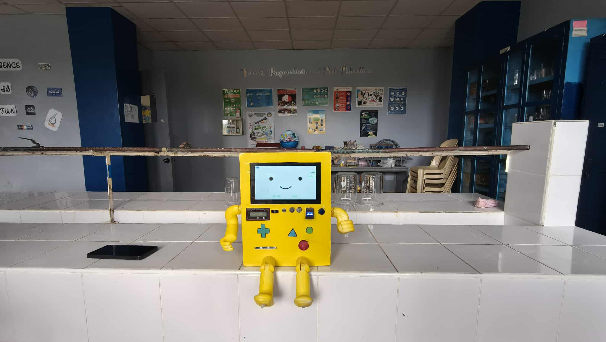

# STIMO Robot

Developed as a Computer Engineering Capstone Thesis at STI College Kalibo.

## Overview

STIMO (Student Technology for Interactive Modes and Operations) is an IoT-based robotic assistant developed as a Computer Engineering Capstone Thesis. The project integrates hardware and software using Python and Raspberry Pi 4 to create an interactive platform designed for student assistance, automation, and intelligent device interaction.

STIMO features Siri-like Text-to-Speech (TTS) and Speech-to-Text (STT) functionalities that enable voice-based communication and assistance for student needs through integration with STI’s eLMS (Student Learning Management System) platform. The system also functions as a standalone computing device capable of performing regular PC tasks, while providing interactive features through its different operating modes, combining education, entertainment, and automation into a single robotic assistant platform.

---

## Modes

### PC Mode
A standard computer mode that allows STIMO to function as a regular personal computer. Users can perform everyday computing tasks, access applications, browse the web, and utilize the system like a conventional desktop environment.

### Game Mode
An interactive entertainment and educational mode that provides users with built-in games and activities designed to enhance engagement and learning while utilizing STIMO as a multifunctional platform.

### STIMO Mode
The main robotic assistant mode that enables voice interaction through Text-to-Speech (TTS) and Speech-to-Text (STT) capabilities. This mode provides student-focused assistance, including academic reminders, eLMS integration, and interactive automation features through voice commands and system responses.

---

## Features

- Voice-based interaction using Speech-to-Text (STT) and Text-to-Speech (TTS)
- STI eLMS platform integration for student assistance and reminders
- IoT-based device interaction and automation
- Multiple operating modes for different user needs
- PC functionality for general computing tasks
- Educational and interactive game features
- Hardware and software integration

---

## Technologies Used

- Python
- Raspberry Pi 4
- Raspberry Pi OS
- IoT Technologies
- Embedded Systems Integration

## Project Images

### STIMO During Exhibit

### STIMO Group Photo

### eLMS Integration

### Gaming Mode

### Robot Emotes

### Internal Components

---

## Source Code

The `source-code` folder contains the core Python files used in the development of STIMO.

### Main Modules

- **main.py** – Main program that initializes and manages the STIMO system.
- **calendar.py** – Handles calendar scheduling and reminder functionalities.
- **fingerprint.py** – Implements fingerprint authentication and user verification.
- **gaming.py** – Provides the gaming mode and interactive entertainment features of STIMO.

---

## Documentation

The complete capstone thesis and project documentation are available in the `documentation` folder.

- **final-paper-stimo.pdf** – Complete documentation, system design, implementation, testing, and evaluation of the STIMO project.
